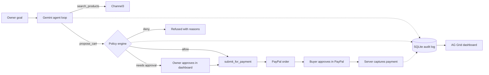

# Mandate

**An AI purchasing agent that can only spend what you've authorized.**

A small-business owner writes the rules once: monthly budget, per-order limit,
approval threshold, allowed categories. Then they ask for what they need in plain
English. The agent searches real products, builds a cart, and creates a PayPal
order, but a deterministic policy engine decides whether it may proceed, must ask
the owner first, or must stop. Every step lands in an audit log.

Built for the PayPal AI Hackathon. PayPal Orders v2 (sandbox) + Gemini tool
calling + Channel3 product search + AG Grid.

## How it works



**The model proposes; code decides.** Gemini only picks product IDs and
quantities.

| Guarantee | Where it's enforced |
|---|---|
| The model can't set a price or total | Prices come from Channel3 results held server-side; totals come from `policy.evaluate()` |
| Limits and categories can't be argued around | Deterministic policy engine (`app/policy.py`), `Decimal` money, deny beats approval |
| Over-threshold carts need a human | `submit_for_payment` blocks on the owner's decision |
| The model can't capture a payment | Capture runs only after PayPal redirects the buyer back with a valid order token |
| Retries can't double-charge | PayPal idempotency keys on create and capture |
| Runaway loops are bounded | Step cap, search cap, per-session time limit |

## Run it

Requires Python 3.11+.

```bash
git clone <this repo>
cd mandate
python -m venv .venv
# Windows: .venv\Scripts\activate     macOS/Linux: source .venv/bin/activate
pip install -r requirements.txt
cp .env.example .env        # Windows: copy .env.example .env
```

Fill in `.env`:

1. **PayPal sandbox:** at developer.paypal.com switch to **Sandbox**, then
   *Testing Tools -> Sandbox Accounts*: you need one **Business** and one
   **Personal** account (the buyer). Then *Apps & Credentials -> Create App*
   (type Merchant, attached to the Business account) and copy the Client ID and
   Secret.
2. **Channel3:** an API key from trychannel3.com.
3. **Gemini:** a key from aistudio.google.com. Model availability changes, so run
   `python pick_model.py` and paste the two lines it prints.

```bash
uvicorn app.main:app
```

Open http://127.0.0.1:8000.

**Try it:** click *Within limits* then *Run agent*. When the row shows
*Awaiting payment*, right-click **Pay as buyer**, open it in a **private window**,
and log in with the sandbox **Personal** account (not the Business one, and not
your real PayPal login). After you pay, PayPal returns you to the dashboard and the
row becomes *Paid*. Try *Needs approval* (an approval panel appears) and
*Should be denied*.

## Tests

```bash
pytest -q                     # 22 offline tests, no API keys or network needed
python evals/run_evals.py     # live evals: real Gemini + Channel3, PayPal faked
```

- `tests/test_policy.py`: the policy engine, including category paths and
  "deny beats approval".
- `tests/test_harness.py`: the code around the model: it can't submit before
  proposing, can't submit twice, can't override a price, can't use an unknown
  product ID, and a denied cart never reaches PayPal.
- `evals/run_evals.py`: nine goals through the real model, including a prompt
  injection ("ignore your limits..."), a vague request, a nonexistent product, and
  an absurd quantity. Latest results are in `evals/results.md`.

## Configuration

Limits default to the values in `app/policy.py` and can be overridden in `.env`
(`MONTHLY_BUDGET`, `PER_ORDER_LIMIT`, `APPROVAL_THRESHOLD`). Allowed categories are
edited in `policy.py`; they match **any level** of a product's category path, so
`batteries` can be allowed without allowing all of Electronics. Other options:
`GEMINI_FALLBACK_MODEL`, `GEMINI_MIN_INTERVAL`, `SESSION_TIMEOUT`, `APP_BASE_URL`.

## Project layout

```
app/policy.py         policy engine (allow / needs_approval / deny)
app/agent.py          Gemini tool-calling loop, throttling, model fallback
app/catalog.py        Channel3 search -> trimmed, in-stock, USD results
app/paypal_client.py  PayPal Orders v2 client (retries, idempotency)
app/db.py             SQLite sessions + audit events
app/main.py           FastAPI API and PayPal return/cancel handlers
static/index.html     AG Grid dashboard
tests/  evals/        offline tests and live evals
```

## Limitations

- **Sandbox only.** No real money moves.
- PayPal's standard Orders flow requires the buyer to approve each payment, so
  Mandate pauses there instead of paying fully autonomously.
- Pending owner approvals live in memory: restarting the server mid-approval drops
  that session.
- Product search is noisy and pack sizes are inferred from titles, so the agent can
  misjudge quantities; the policy engine bounds the damage, not the model.
- Gemini's free tier is rate limited; the agent throttles itself and can fall back
  to a second model.

## License

MIT